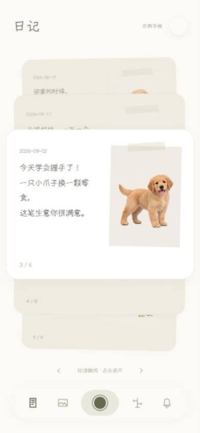

# 爪记 · 宠物成长手记

一款用 MoonBit 编写核心逻辑和界面的宠物成长 PWA。它帮助养宠人按日期保存日记与照片、记录体重变化，并以宠物口吻生成回访文案。本轮根据 BoopLog 公开的 App 截图重做日记与成长页面：米白纸张、手写字体、灰橄榄色、叠放卡片、照片时光轴与浮动工具栏。代码独立实现，示例宠物图片为 AI 生成，非 BoopLog 官方产品。

## 体验入口

运行项目后打开 `http://127.0.0.1:4173/?demo=1` 查看完整示例手帐。打开不带参数的首页使用自己的记录。右上角「更多」可以切换两者。

示例记录只用于展示，不写入你的数据。新增日记或体重会退出示例模式，保存到自己的手帐；刷新后仍显示自己的记录。

## 已完成

- 宠物档案：名字、生日、到家日、头像。
- 成长日记：选择日期，输入文字或添加照片；卡片支持点击、滑动、滚轮和方向键翻阅，点击当前卡片展开详情。
- 体重记录：按日期录入，在照片时光轴与折线图之间切换；图表支持查看更多记录，点击照片查看详情。
- 相册：查看日记照片，点击返回记录详情。透明 PNG 上传保留透明背景。
- 本地数据与迁移：浏览器本地保存，JSON 备份导出与导入。
- 提醒文案：按距离最近一篇日记的天数生成宠物口吻的问候，并可在档案中开关预览。
- PWA：支持安装到主屏幕，静态资源可离线打开。

## 当前边界

照片会在浏览器中压缩后保存到本机存储；清除浏览器数据可能删除记录，请定期导出备份。不同设备之间不会自动同步。iCloud 同步、自动抠图与系统后台推送尚未实现，提醒开关目前只控制应用内的文案预览。请勿把这版演示理解为已具备这些能力。

## 本地运行

需要 [MoonBit CLI](https://www.moonbitlang.com/download/) 和 Node.js。项目使用 MoonBit 模块依赖 moonbit-community/rabbita@0.16.5。

~~~sh
moon update
moon check --target js --deny-warn
moon test --target js --deny-warn
node scripts/build.mjs
node scripts/serve.mjs
~~~

在浏览器打开 <http://127.0.0.1:4173/>。`app/main.mbt` 管理状态与持久化，`app/views.mbt` 实现页面，`app/demo.mbt` 提供独立的示例数据。`pet.mbt` 是可独立测试的日记与提醒核心，`web/` 放置静态外壳和浏览器文件接口。`scripts/build.mjs` 生成 `dist/`。

本地已使用 MoonBit v0.10.15 编译，并通过 3 项核心测试。手机视口和交互检查记录见 [verification.md](docs/verification.md)。这不等于 iPhone Safari 真机验收。

## 部署

仓库包含 vercel.json。Vercel 的 Linux 构建步骤通过 [MoonBit 官方安装脚本](https://cli.moonbitlang.com/install/unix.sh) 安装 CLI，再编译到 dist/。这一步依赖构建时能访问 MoonBit 下载服务。部署后需通过 HTTPS 打开才能正常安装 PWA；iPhone Safari 的主屏幕安装和照片选择仍需在真机复核。

## 参赛准备

本仓库已有可运行示例、测试、MIT 许可证和 GitHub Actions 配置。正式提交前仍需把仓库发布为公开仓库、确认 CI 在 GitHub 上通过、发布 Mooncakes 包、录制演示，并由参赛者亲自写好符合赛事要求的一页项目提案。提交记录应随着真实开发过程累积，不人为拆分或伪造。

设计参考与素材许可见 [design-reference.md](docs/design-reference.md)。Yozai 字体按 SIL OFL 1.1 分发，许可证保留在 `web/assets/Yozai-OFL.txt`。
